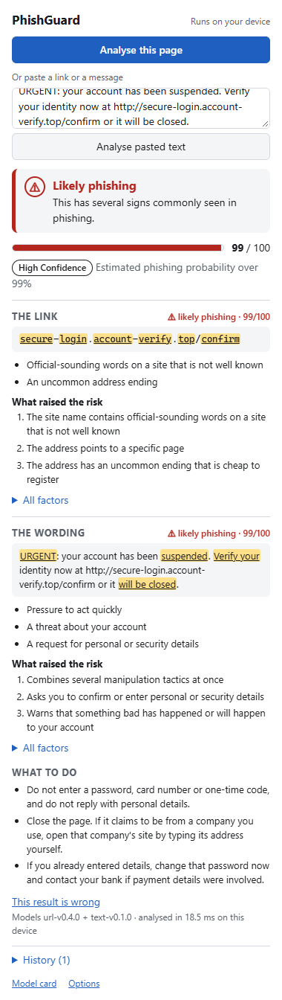
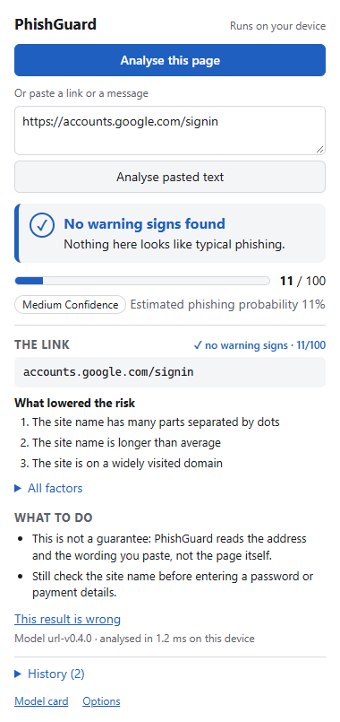
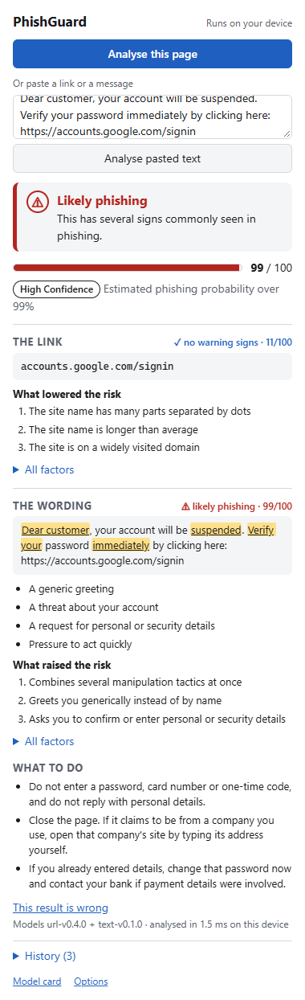

# PhishGuard

A browser extension that tells you whether a link or a message looks like phishing, using
machine-learning models that run **entirely inside your browser**.

**The privacy promise:** PhishGuard never scans anything until you click **Analyse**, and
nothing leaves your device. There is no server. The models and everything they need are
packaged inside the extension.

| A scam message | A real sign-in page | Scam wording, genuine link |
| --- | --- | --- |
|  |  |  |

You click Analyse on a page, or paste a suspicious link, SMS or email. PhishGuard shows a risk
score, how confident it is, the suspicious parts highlighted, the reasons behind the verdict,
and what to do next. A pasted message is judged twice: its link by a URL model and its wording
by a text model. It never says anything is "safe": a clean result means no warning signs were
found, not a guarantee.

## Measured results

Every number below is generated by the pipeline or the benchmark; none is typed by hand. The
full picture, including where the models are weak, is in the
[model card](models/model_card.html).

**URL model** (`url-v0.4.0`, logistic regression over 33 features, 1.1 KB)

| | Value |
| --- | --- |
| Recall at a 1% false-positive rate, held-out test | 65.5% |
| False-positive rate at the shipped threshold, held-out test | 1.01% |
| Well-known legitimate pages wrongly flagged (list never used in design) | 0 of 68 |
| Phishing caught on an independent feed, unseen sites | 54% of 237 |

**Text model** (`text-v0.1.0`, logistic regression over 13 wording signals, 0.7 KB)

| | Value |
| --- | --- |
| Recall at the shipped threshold, held-out test | 36.8% |
| False-positive rate at the shipped threshold, held-out test | 0.55% |
| Ordinary modern messages wrongly flagged (list never used in design) | 0 of 20 |
| Hand-written scam messages caught (same list) | 11 of 12 |

**In the browser:** about 6 ms from clicking Analyse to the verdict (median of 200 runs;
[details](docs/PERFORMANCE.md)).

The held-out test splits contain only sites and message templates the models never saw, with
phishing newer than anything in training.

### Two honest findings

- **A stronger URL model exists and is not shipped.** Gradient boosting scores higher (see the
  model card). The linear model is used because its per-feature contributions are exact, and
  that is what the user is shown as the reason for a verdict.
- **A text model that looked far better was rejected.** A bag-of-words model reaches 96% recall
  on the test split, but flags 11 of 20 ordinary modern messages (delivery updates, one-time
  codes, bank notices). The public training corpora's "legitimate" email is two decades old, so
  the model learns that modern wording is suspicious, and the test split shares that bias. The
  shipped model uses a small set of wording signals instead and flags none of those 20.

## How it works

```
training/  (Python, offline)                       extension/  (TypeScript, in your browser)
  pinned data -> features -> train -> calibrate      popup -> Web Worker (ONNX Runtime Web)
              -> benchmark -> export -> evaluate              reads only the packaged models
                              |                                         ^
                              +---------- models/*.onnx, *.json --------+
```

- **Training** reads data pinned by hash, builds leakage-safe splits (no site or message
  template in two splits; phishing split by date), trains and calibrates the models, exports
  them to ONNX and refuses an export unless ONNX Runtime and scikit-learn agree.
- **The extension** recomputes the same features in TypeScript (tested against values exported
  from Python), runs the ONNX models in a Web Worker, and builds the evidence from the models'
  own coefficients, so the reasons shown are exact, not an approximation.
- **Releases** go through a gate that refuses a model worse than the accepted baseline, a
  registry with one-command rollback, and a weekly drift check.

More detail: [architecture](docs/ARCHITECTURE.md) · [security and privacy](docs/SECURITY.md) ·
[releases, rollback and drift](docs/MLOPS.md) · [model card notes](docs/MODEL_CARD.md) ·
[performance](docs/PERFORMANCE.md) · [changelog](CHANGELOG.md) ·
[beta tester guide](docs/BETA.md)

## Try the extension

Requires Node 20+ and pnpm.

```bash
cd extension
pnpm install
pnpm build
```

Open `chrome://extensions` (or `edge://extensions`), turn on **Developer mode**, choose **Load
unpacked** and select `extension/dist`. Pin PhishGuard, open any page and click **Analyse this
page**, or paste a link or a message into the box.

## Develop

**Extension** (in `extension/`):

```bash
pnpm typecheck && pnpm lint
pnpm test          # unit tests: feature parity with Python, models in ONNX Runtime Web, privacy audit
pnpm build && pnpm test:e2e   # the built extension in a real browser
pnpm bench         # latency benchmark; rewrites models/latency.json and docs/PERFORMANCE.md
pnpm screenshots   # regenerates docs/screenshots/
pnpm icons         # renders icons/icon.svg to the PNG sizes in the manifest
```

End-to-end tests use Playwright's Chromium, or installed Microsoft Edge on Windows. Set
`PW_CHANNEL` to choose another browser.

**Training pipeline** (from the repo root, Python 3.12):

```bash
python -m venv .venv
.venv/Scripts/activate        # Windows; use `source .venv/bin/activate` elsewhere
pip install -r training/requirements.lock
ruff check .
pytest
```

Get the data, then run everything with one command:

```bash
python -m training.data.fetch --from-snapshot
python -m training.pipeline
python -m training.gate
```

`--from-snapshot` restores the exact files pinned in `training/data/manifest.json` from a
mirror you control, set as `data.snapshot_base_url` in `config.yaml`. It is empty in this
repository because the raw data is deliberately not redistributed (see
[Data and attribution](#data-and-attribution)). To build your own snapshot from the live
sources instead (this re-pins the manifest, so results will differ slightly from the
published ones):

```bash
python -m training.data.fetch phishtank openphish tranco commoncrawl sms_spam nazario spamassassin
```

Releasing, rolling back and monitoring are described in [docs/MLOPS.md](docs/MLOPS.md):

```bash
python -m training.registry register   # record models/ as a challenger
python -m training.shadow              # how its verdicts differ from the champion's
python -m training.registry promote    # refused if the gate fails
python -m training.registry rollback   # restore the previous champion's exact files
python -m training.drift               # has phishing shifted since training?
```

## Repository layout

| Path | What lives there |
| --- | --- |
| `training/` | URL pipeline: fetch, load, split, features, train, calibrate, benchmark, export, evaluate |
| `training/text/` | Text model: lexicon, features, data, pipeline |
| `training/gate.py`, `registry.py`, `shadow.py`, `drift.py` | Release gate, registry and rollback, shadow comparison, drift report |
| `models/` | The published release: ONNX files, metadata, known-sites list, model card, metrics, baseline |
| `extension/` | MV3 extension: popup, options, worker, tests |
| `docs/` | Architecture, security, MLOps, model card notes, performance, screenshots |
| `config.yaml` | Every setting that changes a model, the gate or the drift alert |
| `.github/workflows/` | CI for the models and the extension, and the weekly drift job |

## Known limitations

- The URL model reads only the address. It cannot see a fake login form on a legitimate
  platform.
- The text model catches well under half of the scam messages in its own test split. It is a
  second opinion on wording, not a filter, and it knows only English phrases.
- Page content is never analysed: the text model sees only what you paste.
- Phishing changes constantly, so accuracy degrades between retrains.

## Data and attribution

- Phishing URLs: [PhishTank](https://phishtank.org/) and [OpenPhish](https://openphish.com/).
- Benign URLs: [Common Crawl](https://commoncrawl.org/), ranked with the
  [Tranco list](https://tranco-list.eu/).
- Phishing email: Jose Nazario's phishing corpus, licensed CC-BY-4.0.
- Legitimate email: the SpamAssassin public corpus.
- SMS: the UCI SMS Spam Collection.

**The raw data is not redistributed here, on purpose.** OpenPhish's terms forbid passing its
feed to third parties, PhishTank publishes no licence to republish its dump, and Common
Crawl's licence is non-transferable. Only hashes of the files used are committed
(`training/data/manifest.json`), together with the trained models and a list of well-known
domains derived from Tranco. As a result CI tests the code and gates the committed models,
but does not retrain them; retraining needs your own copy of the data.

## Roadmap

- **v0.1** — URL model, ONNX export, scored in the browser ✔
- **v0.2** — MVP extension: Analyse flow, evidence, history and feedback, MLflow, CI gate ✔
- **v0.3** — text model for message wording, quantisation measured ✔
- **v1.0** — registry with rollback, shadow comparison, drift report ✔ · store listing, demo
  video and beta feedback still to do

## License

MIT
